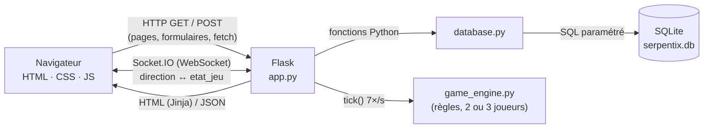

# Architecture technique (Serpentix)

## Vue d’ensemble

Trois fichiers Python, trois rôles :

| Fichier | Rôle | Ne fait PAS |
|---|---|---|
| `app.py` | Routes, validation serveur, sessions, CSRF, Socket.IO, boucle de jeu | de SQL |
| `database.py` | Toutes les requêtes SQL | de HTML |
| `game_engine.py` | Règles du jeu (déplacements, collisions, bonus) | ni Flask ni SQL |

## Flux d’un formulaire (exemple : inscription)

1. Le navigateur affiche `/inscription` (GET) : Flask rend `inscription.html`
   avec un jeton CSRF caché.
2. À l’envoi, `validation.js` vérifie les champs. En cas d’erreur, l’envoi est
   bloqué et les messages s’affichent sous les champs.
3. Sinon le formulaire part en POST. `verifier_csrf()` contrôle le jeton, puis
   `inscription()` revalide tout en Python (`valider_pseudo`, `valider_email`,
   `valider_mot_de_passe`, unicité en base).
4. `database.creer_utilisateur()` exécute `INSERT INTO utilisateurs …` avec des
   paramètres `?` et un mot de passe haché.
5. Flask enregistre `user_id` dans la session (cookie signé) et redirige vers `/jouer`.

## Flux d’une partie à 2 ou 3

1. Joueur A choisit 2 ou 3 joueurs (boutons radio) : `fetch POST
   /api/partie/creer {nb_joueurs}`. Flask vérifie que la valeur vaut 2 ou 3,
   tire un code unique, insère la partie (`statut = 'attente'`, `nb_joueurs`)
   et crée un `PartieEnCours(max_joueurs=…)` en mémoire.
2. Les autres : `fetch POST /api/partie/rejoindre {code}`. Flask vérifie le
   format, l’existence, le statut et qu’il reste de la place.
3. Chaque page `/partie/<code>` ouvre une connexion Socket.IO et envoie
   `rejoindre_salle`. Quand la salle est pleine, le moteur donne les places de
   départ (`_placer_serpents`), la partie passe `en_cours` (compte à rebours de
   3 s) et chaque joueur reçoit sa ligne dans `participations`.
4. Le thread `boucle_jeu()` appelle `tick()` toutes les 1/7 s
   (`TICKS_PAR_SECONDE`) et diffuse `etat_jeu` à tous les joueurs (la « room » du code).
5. Chaque touche envoie `direction {dx, dy}` ; le moteur la met dans une file
   et refuse les demi-tours.
6. Un serpent éliminé reste affiché en contour ; à 3, la partie continue tant
   qu’il reste 2 serpents. Un joueur qui part est éliminé (à 2, l’autre gagne
   par forfait).
7. À la fin, `cloturer_partie()` écrit le résultat **une seule fois**
   (`terminer_partie` : score et `a_gagne` de chacun des 2 ou 3 joueurs),
   verse les coins et libère la mémoire. Le navigateur affiche l’écran de fin
   animé (`fin.js`) : victoire, défaite ou match nul.

Le serveur est **autoritaire** : le navigateur ne fait que dessiner l’état reçu,
donc modifier `game.js` ne permet pas de tricher.

## Flux du solo et des coins

Le solo tourne entièrement dans le navigateur (`solo.js`, mêmes règles que le
moteur). Les réglages (vitesse, durées des bonus…) viennent de
`game_engine.reglages_client()`, injectés par Flask dans `solo.html` : une seule
source de vérité. Pour éviter qu’on s’invente des coins :

1. au départ, `POST /api/solo/debut` : le serveur note l’heure **dans sa mémoire** ;
2. à la fin, `POST /api/solo/fin {score}` : le serveur refuse s’il n’y a pas de
   partie commencée, efface l’heure (une partie n’est payée qu’une fois) et
   plafonne le gain à `min(score, durée × 1,5, 80)`.

## Liste des routes

| Méthode | Route | Fonction | Connexion requise | Rôle |
|---|---|---|---|---|
| GET | `/` | `accueil` | non | Page de présentation |
| GET, POST | `/inscription` | `inscription` | non | CREATE compte |
| GET, POST | `/connexion` | `connexion` | non | Connexion |
| GET | `/deconnexion` | `deconnexion` | non | Déconnexion |
| GET, POST | `/profil` | `profil` | oui | UPDATE e-mail / mot de passe |
| GET, POST | `/boutique` | `boutique` | oui | Acheter / équiper un skin |
| GET | `/classement?tri=…` | `classement` | non | Podium + classement SQL triable |
| GET | `/jouer` | `jouer` | oui | Hub solo / multijoueur |
| GET | `/partie/<code>` | `partie` | oui | Salle de 2 ou 3 |
| GET | `/solo` | `solo` | oui | Mode solo |
| GET | `/utilisateurs` | `liste_utilisateurs` | oui | READ tous |
| GET | `/utilisateurs/<id>` | `detail_utilisateur` | oui | READ un |
| GET, POST | `/utilisateurs/<id>/modifier` | `modifier_utilisateur` | oui (soi) | UPDATE |
| POST | `/utilisateurs/<id>/supprimer` | `supprimer_utilisateur` | oui (soi) | DELETE |
| GET, POST | `/utilisateurs/nouveau` | `nouvel_utilisateur` | oui | CREATE |
| POST | `/api/partie/creer` | `api_creer_partie` | oui | Créer une salle `{nb_joueurs: 2 ou 3}` (JSON) |
| POST | `/api/partie/rejoindre` | `api_rejoindre_partie` | oui | Vérifier un code (JSON) |
| POST | `/api/solo/debut` | `api_solo_debut` | oui | Début d’une partie solo |
| POST | `/api/solo/fin` | `api_solo_fin` | oui | Crédit des coins solo |

Tous les POST exigent le jeton CSRF (champ `csrf_token` ou en-tête `X-CSRF-Token`).

## Événements Socket.IO

| Sens | Événement | Données | Effet |
|---|---|---|---|
| client → serveur | `rejoindre_salle` | `{code}` | Entre dans la salle ; démarre quand elle est pleine (2 ou 3) |
| client → serveur | `direction` | `{code, dx, dy}` | Virage (mis en file, demi-tour refusé) |
| client → serveur | `quitter_salle` | `{code}` | Quitte (forfait si la partie a commencé) |
| client → serveur | `disconnect` | — | Connexion perdue : même chose que quitter |
| serveur → clients | `etat_jeu` | `{statut, decompte, nb_joueurs, max_joueurs, serpents (avec effets), pommes, bonus, evenements, message_fin, vainqueur_id, vainqueur_couleur}` | Redessiner (7 fois/s) |
| serveur → clients | `partie_lancee` | `{code}` | La salle est pleine |
| serveur → client | `erreur` | `{message}` | Salle pleine, introuvable, déjà dedans… |

## Fichiers JavaScript

| Fichier | Pages | Rôle |
|---|---|---|
| `main.js` | toutes | Menu ☰ sur mobile |
| `bg-snake.js` | accueil, Jouer | Arène : plusieurs serpents automatiques chassent les pommes, se percutent, réapparaissent (requestAnimationFrame, ~30 images/s, pause quand l’onglet est caché) |
| `validation.js` | formulaires | Validation côté client |
| `lobby.js` | `/jouer` | Créer une salle (2 ou 3) / rejoindre |
| `dessin.js` | accueil, solo, partie | Dessin du plateau, pictogrammes des bonus, HUD des effets (partagé) |
| `controles.js` | solo, partie | Clavier, glisser, flèches tactiles + verrou de défilement (partagé) |
| `fin.js` | solo, partie | Écrans de fin animés (particules canvas + titre animé en CSS) |
| `solo.js` | `/solo` | Boucle du solo + crédit des coins |
| `game.js` | `/partie/<code>` | Client Socket.IO des parties à 2 ou 3 |

## Pages de jeu : la page ne bouge pas

Pendant une partie, la page ne doit pas défiler (sinon le plateau sort de
l’écran). Deux protections :

1. **CSS** : `body.page-jeu` fait `100vh` avec `overflow: hidden` ; le plateau
   garde ses proportions 4/3 et sa hauteur maximale est calculée pour tenir
   dans l’écran (`max-height: calc(100vh - …)`), pied de page caché.
2. **JavaScript** (`Controles.verrouiller()`) : `preventDefault()` sur la
   molette (`wheel`), le doigt (`touchmove`) et les touches qui font défiler
   (flèches, espace, Page haut/bas, ZQSD/WASD). Ces écouteurs sont déclarés avec
   `{passive: false}`, sinon le navigateur ignore `preventDefault()`. Le verrou
   est retiré à l’écran de fin (`Controles.deverrouiller()`).

Le plateau n’accepte ni sélection de texte ni glisser-déposer (`user-select:
none`, `dragstart` annulé).
