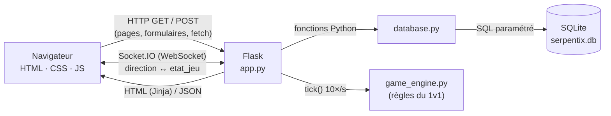

# Architecture technique (Serpentix)

## Vue d’ensemble

Trois fichiers Python, trois rôles :

| Fichier | Rôle | Ne fait PAS |
|---|---|---|
| `app.py` | Routes, validation serveur, sessions, CSRF, Socket.IO, boucle de jeu | de SQL |
| `database.py` | Toutes les requêtes SQL | de HTML |
| `game_engine.py` | Règles du jeu (déplacements, collisions, bonus) | ni Flask ni SQL |

## Flux d’un formulaire (exemple : inscription)

1. Le navigateur affiche `/inscription` (GET) : Flask rend `inscription.html`
   avec un jeton CSRF caché.
2. À l’envoi, `validation.js` vérifie les champs. En cas d’erreur, l’envoi est
   bloqué et les messages s’affichent sous les champs.
3. Sinon le formulaire part en POST. `verifier_csrf()` contrôle le jeton, puis
   `inscription()` revalide tout en Python (`valider_pseudo`, `valider_email`,
   `valider_mot_de_passe`, unicité en base).
4. `database.creer_utilisateur()` exécute `INSERT INTO utilisateurs …` avec des
   paramètres `?` et un mot de passe haché.
5. Flask enregistre `user_id` dans la session (cookie signé) et redirige vers `/jouer`.

## Flux d’une partie 1v1

1. Joueur A : `fetch POST /api/partie/creer`. Flask tire un code unique,
   insère la partie (`statut = 'attente'`) et crée un `PartieEnCours` en mémoire.
2. Joueur B : `fetch POST /api/partie/rejoindre {code}`. Flask vérifie le
   format, l’existence, le statut et la place.
3. Les deux pages `/partie/<code>` ouvrent une connexion Socket.IO et envoient
   `rejoindre_salle`. Au 2e joueur, la partie passe `en_cours` (compte à rebours de 3 s).
4. Le thread `boucle_jeu()` appelle `tick()` toutes les 0,1 s et diffuse
   `etat_jeu` aux deux joueurs (la « room » du code).
5. Chaque touche envoie `direction {dx, dy}` ; le moteur la met dans une file
   et refuse les demi-tours.
6. À la fin (ou si un joueur part : forfait), `cloturer_partie()` écrit le
   résultat **une seule fois** (`terminer_partie`), verse les coins et libère la mémoire.

Le serveur est **autoritaire** : le navigateur ne fait que dessiner l’état reçu,
donc modifier `game.js` ne permet pas de tricher.

## Flux du solo et des coins

Le solo tourne entièrement dans le navigateur (`solo.js`, mêmes règles que le
moteur). Pour éviter qu’on s’invente des coins :

1. au départ, `POST /api/solo/debut` : le serveur note l’heure **dans sa mémoire** ;
2. à la fin, `POST /api/solo/fin {score}` : le serveur refuse s’il n’y a pas de
   partie commencée, efface l’heure (une partie n’est payée qu’une fois) et
   plafonne le gain à `min(score, durée × 1,5, 80)`.

## Liste des routes

| Méthode | Route | Fonction | Connexion requise | Rôle |
|---|---|---|---|---|
| GET | `/` | `accueil` | non | Page de présentation |
| GET, POST | `/inscription` | `inscription` | non | CREATE compte |
| GET, POST | `/connexion` | `connexion` | non | Connexion |
| GET | `/deconnexion` | `deconnexion` | non | Déconnexion |
| GET, POST | `/profil` | `profil` | oui | UPDATE e-mail / mot de passe |
| GET, POST | `/boutique` | `boutique` | oui | Acheter / équiper un skin |
| GET | `/classement` | `classement` | non | Classement SQL |
| GET | `/jouer` | `jouer` | oui | Hub solo / 1v1 |
| GET | `/partie/<code>` | `partie` | oui | Salle 1v1 |
| GET | `/solo` | `solo` | oui | Mode solo |
| GET | `/utilisateurs` | `liste_utilisateurs` | oui | READ tous |
| GET | `/utilisateurs/<id>` | `detail_utilisateur` | oui | READ un |
| GET, POST | `/utilisateurs/<id>/modifier` | `modifier_utilisateur` | oui (soi) | UPDATE |
| POST | `/utilisateurs/<id>/supprimer` | `supprimer_utilisateur` | oui (soi) | DELETE |
| GET, POST | `/utilisateurs/nouveau` | `nouvel_utilisateur` | oui | CREATE |
| POST | `/api/partie/creer` | `api_creer_partie` | oui | Créer une salle (JSON) |
| POST | `/api/partie/rejoindre` | `api_rejoindre_partie` | oui | Vérifier un code (JSON) |
| POST | `/api/solo/debut` | `api_solo_debut` | oui | Début d’une partie solo |
| POST | `/api/solo/fin` | `api_solo_fin` | oui | Crédit des coins solo |

Tous les POST exigent le jeton CSRF (champ `csrf_token` ou en-tête `X-CSRF-Token`).

## Événements Socket.IO

| Sens | Événement | Données | Effet |
|---|---|---|---|
| client → serveur | `rejoindre_salle` | `{code}` | Entre dans la salle ; démarre au 2e joueur |
| client → serveur | `direction` | `{code, dx, dy}` | Virage (mis en file, demi-tour refusé) |
| client → serveur | `quitter_salle` | `{code}` | Quitte (forfait si la partie a commencé) |
| client → serveur | `disconnect` | — | Connexion perdue : même chose que quitter |
| serveur → clients | `etat_jeu` | `{statut, decompte, serpents, pommes, bonus, message_fin, vainqueur_id…}` | Redessiner (10 fois/s) |
| serveur → clients | `partie_lancee` | `{code}` | Les deux joueurs sont là |
| serveur → client | `erreur` | `{message}` | Salle pleine, introuvable, déjà dedans… |

## Fichiers JavaScript

| Fichier | Pages | Rôle |
|---|---|---|
| `main.js` | toutes | Menu ☰ sur mobile |
| `bg-snake.js` | toutes sauf jeu | Serpent décoratif qui joue seul |
| `validation.js` | formulaires | Validation côté client |
| `lobby.js` | `/jouer` | Créer / rejoindre une salle |
| `dessin.js` | solo, partie | Dessin du plateau (partagé) |
| `controles.js` | solo, partie | Clavier, glisser, flèches tactiles (partagé) |
| `solo.js` | `/solo` | Boucle du solo + crédit des coins |
| `game.js` | `/partie/<code>` | Client Socket.IO du 1v1 |
