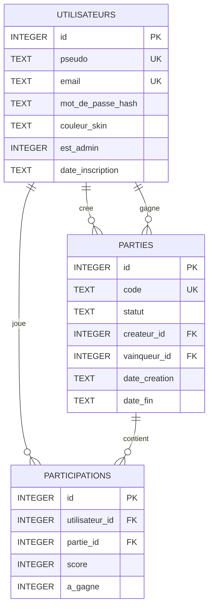

# Schéma de la base de données — Serpentix

Base : **SQLite** (`serpentix.db`), créée depuis `schema.sql` au premier lancement.

## Diagramme (Mermaid)

## Tables

### `utilisateurs`

| Colonne | Type | Contraintes | Rôle |
|---------|------|-------------|------|
| `id` | INTEGER | PK, AUTOINCREMENT | Identifiant |
| `pseudo` | TEXT | NOT NULL, UNIQUE | Nom affiché |
| `email` | TEXT | NOT NULL, UNIQUE | Contact / login secondaire |
| `mot_de_passe_hash` | TEXT | NOT NULL | Hash Werkzeug |
| `couleur_skin` | TEXT | NOT NULL, défaut `#22c55e` | Couleur du serpent |
| `est_admin` | INTEGER | NOT NULL, défaut 0 | 1 = admin |
| `date_inscription` | TEXT | NOT NULL | Horodatage local |

### `parties`

| Colonne | Type | Contraintes | Rôle |
|---------|------|-------------|------|
| `id` | INTEGER | PK | Identifiant |
| `code` | TEXT | NOT NULL, UNIQUE | Code de salle (6 car.) |
| `statut` | TEXT | NOT NULL | `attente` / `en_cours` / `terminee` |
| `createur_id` | INTEGER | FK → utilisateurs | Qui a créé |
| `vainqueur_id` | INTEGER | FK → utilisateurs, NULL | Gagnant |
| `date_creation` | TEXT | NOT NULL | Début |
| `date_fin` | TEXT | NULL | Fin |

### `participations`

Table d’association **N–N** entre utilisateurs et parties (avec score).

| Colonne | Type | Contraintes | Rôle |
|---------|------|-------------|------|
| `id` | INTEGER | PK | Identifiant |
| `utilisateur_id` | INTEGER | FK, CASCADE | Joueur |
| `partie_id` | INTEGER | FK, CASCADE | Partie |
| `score` | INTEGER | défaut 0 | Pommes mangées |
| `a_gagne` | INTEGER | défaut 0 | 1 si vainqueur |

Contrainte `UNIQUE (utilisateur_id, partie_id)` : un joueur ne figure qu’une fois par partie.

## Opérations CRUD (exigence NSI)

| Action | Route / écran | SQL |
|--------|---------------|-----|
| **Create** | `/inscription`, `/utilisateurs/nouveau` | `INSERT INTO utilisateurs` |
| **Read** (liste) | `/utilisateurs` | `SELECT … FROM utilisateurs` |
| **Read** (un) | `/utilisateurs/<id>` | `SELECT … WHERE id = ?` |
| **Update** | `/utilisateurs/<id>/modifier`, `/profil` | `UPDATE utilisateurs SET …` |
| **Delete** | bouton « Supprimer » (POST) | `DELETE FROM utilisateurs WHERE id = ?` |

Toutes les requêtes utilisent des **paramètres liés** (`?`) pour éviter les injections SQL.
