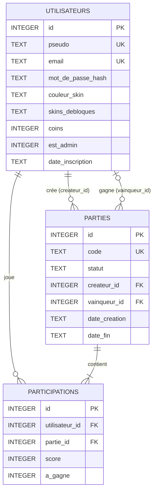

# Schéma de la base de données (Serpentix)

Base **SQLite**, fichier `serpentix.db`, créée par `schema.sql` au premier
lancement (`database.init_db()`). Toutes les requêtes sont dans `database.py`.

## Diagramme entité-association (Mermaid)



`participations` est la **table d’association** qui relie utilisateurs et
parties (relation plusieurs-à-plusieurs) et porte le score de chaque joueur.

## Tables

### `utilisateurs`

| Colonne | Type | Contraintes | Rôle |
|---|---|---|---|
| `id` | INTEGER | PK, AUTOINCREMENT | Identifiant |
| `pseudo` | TEXT | NOT NULL, UNIQUE | Nom affiché |
| `email` | TEXT | NOT NULL, UNIQUE | E-mail (unicité) |
| `mot_de_passe_hash` | TEXT | NOT NULL | Empreinte du mot de passe (Werkzeug, scrypt) |
| `couleur_skin` | TEXT | NOT NULL, défaut `#ffffff` | Skin équipé (couleur hex) |
| `skins_debloques` | TEXT | NOT NULL, défaut `blanc` | Skins possédés, séparés par des virgules |
| `coins` | INTEGER | NOT NULL, défaut 0 | Monnaie du jeu |
| `est_admin` | INTEGER | NOT NULL, défaut 0 | Non utilisé dans l’interface (toujours 0) |
| `date_inscription` | TEXT | NOT NULL, défaut maintenant | Date d’inscription |

### `parties`

| Colonne | Type | Contraintes | Rôle |
|---|---|---|---|
| `id` | INTEGER | PK | Identifiant |
| `code` | TEXT | NOT NULL, UNIQUE | Code de salle (6 caractères A-Z 0-9) |
| `statut` | TEXT | NOT NULL, défaut `attente` | `attente` → `en_cours` → `terminee` |
| `createur_id` | INTEGER | FK → utilisateurs, ON DELETE CASCADE | Créateur de la salle |
| `vainqueur_id` | INTEGER | FK → utilisateurs, NULL, ON DELETE SET NULL | Gagnant (NULL = nul ou pas fini) |
| `date_creation` | TEXT | NOT NULL | Création |
| `date_fin` | TEXT | NULL | Fin |

### `participations`

| Colonne | Type | Contraintes | Rôle |
|---|---|---|---|
| `id` | INTEGER | PK | Identifiant |
| `utilisateur_id` | INTEGER | FK, ON DELETE CASCADE | Joueur |
| `partie_id` | INTEGER | FK, ON DELETE CASCADE | Partie |
| `score` | INTEGER | défaut 0 | Pommes mangées |
| `a_gagne` | INTEGER | défaut 0 | 1 si vainqueur |

Contrainte `UNIQUE (utilisateur_id, partie_id)` : un joueur n’apparaît qu’une
fois par partie. Index : `idx_participations_score`, `idx_parties_code`.

## Opérations CRUD

| Action | Page | Fonction | SQL |
|---|---|---|---|
| **Create** | `/inscription`, `/utilisateurs/nouveau` | `creer_utilisateur` | `INSERT INTO utilisateurs …` |
| **Read** (tous) | `/utilisateurs` | `lister_utilisateurs` | `SELECT … FROM utilisateurs ORDER BY …` |
| **Read** (un) | `/utilisateurs/<id>` | `obtenir_utilisateur` | `SELECT * FROM utilisateurs WHERE id = ?` |
| **Update** | `/utilisateurs/<id>/modifier`, `/profil` | `mettre_a_jour_utilisateur` | `UPDATE utilisateurs SET … WHERE id = ?` |
| **Delete** | bouton « Supprimer » (POST) | `supprimer_utilisateur` | `DELETE FROM utilisateurs WHERE id = ?` |

## Exemples de requêtes réellement utilisées (database.py)

Connexion (pseudo sans tenir compte des majuscules) :

```sql
SELECT * FROM utilisateurs WHERE LOWER(pseudo) = LOWER(?);
```

Gain de coins **atomique** (calculé par SQLite, aucun gain perdu si deux
arrivent en même temps) :

```sql
UPDATE utilisateurs SET coins = coins + ? WHERE id = ?;
```

Achat d’un skin : le `WHERE coins >= ?` empêche de passer en négatif.

```sql
UPDATE utilisateurs
SET coins = coins - ?, skins_debloques = ?
WHERE id = ? AND coins >= ?;
```

Suppression d’un compte (une transaction, dans cet ordre) :

```sql
UPDATE parties SET vainqueur_id = NULL WHERE vainqueur_id = ?;
DELETE FROM parties WHERE createur_id = ?;      -- leurs participations partent en cascade
DELETE FROM utilisateurs WHERE id = ?;          -- ses participations aussi
```

Clôture d’une partie (le `statut != 'terminee'` évite de payer deux fois) :

```sql
UPDATE parties
SET statut = 'terminee', vainqueur_id = ?, date_fin = datetime('now', 'localtime')
WHERE id = ? AND statut != 'terminee';

UPDATE participations SET score = ?, a_gagne = ?
WHERE partie_id = ? AND utilisateur_id = ?;
```

Classement (jointures externes + agrégats, seules les parties terminées comptent) :

```sql
SELECT u.id, u.pseudo, u.couleur_skin, u.coins,
       COUNT(pa.id)                AS parties_jouees,
       COALESCE(SUM(p.a_gagne), 0) AS victoires,
       COALESCE(SUM(p.score), 0)   AS score_total
FROM utilisateurs u
LEFT JOIN participations p ON p.utilisateur_id = u.id
LEFT JOIN parties pa ON pa.id = p.partie_id AND pa.statut = 'terminee'
GROUP BY u.id
ORDER BY victoires DESC, score_total DESC, u.coins DESC, u.pseudo ASC
LIMIT ?;
```

Historique d’un joueur :

```sql
SELECT pa.code, pa.statut, pa.date_creation, pa.date_fin,
       p.score, p.a_gagne, pa.vainqueur_id
FROM participations p
JOIN parties pa ON pa.id = p.partie_id
WHERE p.utilisateur_id = ?
ORDER BY pa.date_creation DESC, pa.id DESC
LIMIT ?;
```

Toutes les valeurs passent par des **paramètres liés** `?` : ce que tape
l’utilisateur n’est jamais collé dans le texte SQL, donc `' OR 1=1 --` ne
fait rien.

## Catalogue des skins

Fixe, dans `database.SKINS` (pas une table, car il ne change pas en jeu) :

| id | Couleur | Prix |
|---|---|---|
| blanc | `#ffffff` | 0 |
| rouge | `#ef4444` | 40 |
| vert | `#22c55e` | 40 |
| orange | `#f97316` | 60 |
| jaune | `#eab308` | 60 |
